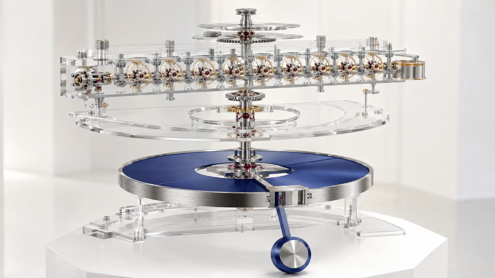
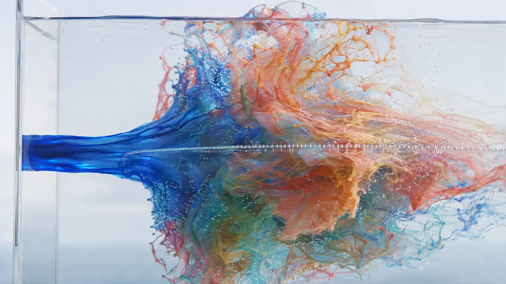
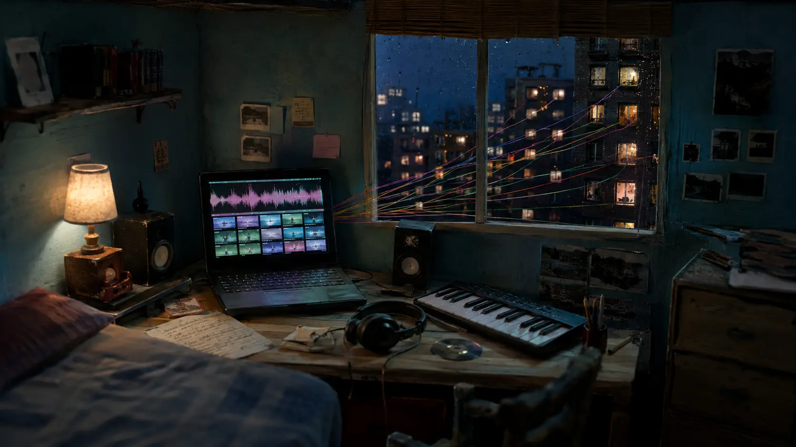

*Chillstep trance is not simply trance made slower or dubstep made prettier. Its characteristic sensation comes from a contradiction: the music advances and floats at the same time.*

Listen to a typical example without looking at a tempo display. The snare seems to arrive at the pace of a slow song. Pads hang in the air. A piano phrase is given enough silence to leave an afterimage. Yet inside this broad motion, an arpeggio may be running rapidly, a filtered pulse may be climbing toward release, and the harmony may carry the same anticipatory force as vocal trance.

The body hears one clock. The imagination hears another.

That doubleness is the most useful way to understand **chillstep trance**: not as a rigidly policed genre, but as a borderland where the half-time physics of dubstep carries the harmonic psychology of trance through ambient space. At its best, the style preserves euphoria without demanding constant impact. It can be huge without becoming hard, emotional without becoming a conventional ballad, and calm without becoming motionless.

The name is imprecise. Artists more often describe themselves as chillstep, melodic dubstep, melodic bass, ambient, chillout or trance. Stores and databases rarely maintain “chillstep trance” as a stable shelf. That does not make the sound imaginary. It means the most interesting musical territory developed faster than the vocabulary used to file it.

*One grid, two perceived speeds: trance runs along the glass rail while chillstep moves like the wave beneath it. An original 0zkMusic illustration.*

## A borderland, not a birth certificate

Genre histories often become searches for a first record, first producer or first use of a word. That method works poorly here.

Chillstep itself emerged from dubstep's late-2000s and early-2010s dispersal. It retained the deep sub-bass, roughly 140 BPM grid and half-time drum logic of dubstep, but reduced abrasive midrange modulation and foregrounded atmosphere, melody, piano, strings and airy voice. Blackmill, Phaeleh, SizzleBird, MitiS and Rameses B became recurring names in the online listening culture around the style. The compact definition is useful, but it explains only one parent.

The other parent is trance—not necessarily the full four-on-the-floor arrangement, but its emotional machinery:

- repeating minor-key chord cycles that feel as if they are continually becoming;
- arpeggios and gated pulses that divide time into luminous particles;
- long rises in spectral brightness and registral height;
- breakdowns that suspend the rhythm while enlarging the harmony;
- female vocals or nonverbal vocal fragments treated as emotional altitude;
- release organized around melodic recognition rather than rhythmic surprise.

Many chillstep tracks contain several of these features without becoming club trance. Many trance producers, meanwhile, have made downtempo versions that lose the kick but retain the harmonic journey. The hybrid therefore has no single gate. It can be entered from either side.

This article uses **chillstep trance** as an analytical name for music that substantially combines three properties:

1. a half-time, broken or strongly softened rhythmic body;
2. trance-like harmonic direction, arpeggiation or breakdown-and-release psychology;
3. spacious, low-impact production designed as much for inward listening as for dance-floor force.

Not every calm trance track qualifies. Not every melodic dubstep track qualifies. A track with a giant aggressive bass drop and a sentimental verse may be melodic dubstep, but its center of gravity is impact. A beatless psybient piece may possess hypnotic sequence and enormous atmosphere, but if it lacks the half-time bass-music body, it reaches the border from somewhere else.

The ambiguity is not a flaw to eliminate. It is the history.

## Three rivers meet

The hybrid formed where three older ideas became compatible.

The first was **trance as directed emotion**. From progressive and Balearic trance came the long harmonic horizon: music that makes expectation itself pleasurable. Chicane's *Far from the Maddening Crowds* and *Behind the Sun* showed how oceanic ambience, song and trance pulse could occupy one album. Roger Shah's Sunlounger project later made the relationship explicit by presenting Balearic material in club and downtempo forms; the 2007 ***Another Day on the Terrace*** collection is a particularly clear ancestor.

The second was **dubstep as weight plus empty space**. Original dubstep did not require a wall of harsh “wobble.” Its sub-bass, sparse drums and half-time feel already created a strange perceptual scale: enormous low frequencies separated by air. Producers could replace menace with consonant harmony without discarding that architecture.

The third was **ambient as acoustic distance**. Ambient contributed more than pads. It taught producers that foreground and background could exchange roles, that reverb could imply an imaginary environment, and that timbral change could provide form when conventional melody became sparse.

Around 2010, cheap software, home broadband, SoundCloud, YouTube channels and downloadable mixes made these ideas available to producers who did not need permission from one established scene. A track could be built on a dubstep grid, borrow a trance progression, use ambient production, circulate under the tag “chillstep,” and be heard beside game footage, anime edits, landscape photography or a two-hour study mix.

*Trance supplied direction, dubstep supplied weight and negative space, and ambient supplied distance. No single river can claim the estuary. An original 0zkMusic illustration.*

## The central invention: two clocks at once

The usual tempo number conceals what the listener experiences.

At 140 BPM, one quarter note lasts approximately:

\[
\frac{60}{140} \approx 0.429 \text{ seconds}
\]

Place a strong snare on beat three of a 4/4 bar and the main backbeat arrives every two quarter notes:

\[
2 \times 0.429 \approx 0.857 \text{ seconds}
\]

That interval corresponds to a perceived pulse of about 70 BPM. The project may still be sequenced at 140. Hats, arpeggios, delays and automation can use that fast grid. But the body organizes itself around the slow backbeat.

This is more than a production convention. It creates the genre's emotional paradox.

At the slow level, there is room for grief, breath and suspended attention. At the fast level, there is continuity and anticipation. The music can feel exhausted and hopeful in the same bar. Trance's forward arrow remains active inside chillstep's broad present.

The technique also changes how silence behaves. In four-on-the-floor trance, each kick confirms the floor. In half-time music, a missing kick is not necessarily a breakdown; it is part of the groove's normal openness. Pads, reverberation and vocal tails can occupy those gaps without fighting a constant bass drum.

This is why merely slowing a trance master to 70 BPM does not produce chillstep trance. The internal grid becomes sluggish. Conversely, placing a generic half-time drum loop under supersaws is insufficient. The two clocks must be composed together: fast detail must animate slow mass.

*The tempo has not been cut in half. Two levels of the same meter have been made equally perceptible. An original 0zkMusic illustration.*

## A practical theory of chillstep trance

No composer issued a formal manifesto for this hybrid. Its theory must be reconstructed from recordings. Several principles recur often enough to form a usable grammar.

### 1. Harmony carries the destination

Aggressive bass music can make the sound-design event itself the destination: tension accumulates, then the drop unveils a new bass patch. In chillstep trance, the deepest reward is usually harmonic. The listener wants the suspended chord to resolve, the vocal note to return, or the opening motif to reappear at full width.

The progressions are often simple. Complexity comes from **voicing and duration**, not necessarily from exotic chord names. A minor-key loop may retain common tones across several chords. Added ninths, suspended seconds, open fifths and inversions reduce the sense of blunt block movement. High notes can remain fixed while the bass changes underneath, creating longing without melodic busyness.

The best tracks are bittersweet rather than merely “uplifting.” Major sonorities may appear inside a minor tonal field, but they do not erase the memory of the tonic. Euphoria is heard as temporary illumination, not permanent victory.

### 2. The bass is a floor, not always a monster

Chillstep inherits dubstep's attention to low-frequency scale, but usually simplifies the mid-bass spectacle. A stable sine-like sub can support the roots while a quieter textured layer provides movement above it. The bass may breathe through filtering, saturation or sidechain control, yet it rarely needs to pronounce a new syllable on every eighth note.

This restraint matters because it allows harmony to remain legible. When every bass event is spectrally dense and highly modulated, the ear follows timbral aggression. When the sub is clean and the middle remains open, the listener can perceive the entire chordal sky above it.

### 3. The drop opens rather than attacks

The word **drop** suggests descent and impact. The characteristic chillstep-trance release often behaves differently. Low end arrives, drums become complete, sidechain movement becomes audible and the lead reaches its widest voicing—but the perceptual motion is outward.

The section feels as if a room has suddenly acquired a horizon.

This “soft drop” can still be powerful. The snare may be large and the sub physically deep. What is reduced is not energy but hostility: fewer serrated midrange layers, less transient violence, more sustained harmonic information, and longer spatial tails.

*A soft drop does not avoid intensity. It redirects intensity from collision into expansion. An original 0zkMusic illustration.*

### 4. Sidechain compression becomes breathing

In dance music, sidechain compression often clears the kick by rapidly reducing the level of pads and bass when the kick hits. In this hybrid it also creates biological motion. A sustained chord seems to inhale between drum events and exhale after them.

Too much pumping turns the track into caricature. Too little leaves the wide pads masking the rhythmic skeleton. The most persuasive examples use different amounts at different depths: the sub makes clean space for the kick; the midrange pad moves gently; the vocal reverb may duck more than the dry voice, allowing intimacy to remain in front while its atmosphere swells behind it.

### 5. Bright detail must not destroy softness

Trance depends heavily on upper-frequency information: arpeggios, noise lifts, hats, bright lead edges and reverberant vocal air. Chillstep needs softness and depth. The producer therefore faces a spectral contradiction.

The answer is not to remove brightness but to **distribute it in time**. A pluck can have a clear attack and then disappear into a dark reverb. A supersaw can be wide without being painfully sharp. Noise can rise between phrases rather than remain as permanent hiss. High-frequency motion is present, but it does not flatten the image into one white surface.

### 6. Voice can be a person or a memory of one

Full vocal performances connect the hybrid to vocal trance and electronic pop. Chopped or wordless fragments connect it to post-dubstep and future garage. Both can work, but they create different centers of gravity.

A complete verse gives the listener a speaker, narrative and human scale. A stretched syllable or distant breath behaves more like light passing through the mix: emotionally suggestive but semantically incomplete. The second approach was especially compatible with online visual culture because it allowed listeners to attach their own story to the track.

### 7. Repetition should accumulate meaning

Weak chillstep repeats a four-chord loop and relies on reverb to simulate depth. Strong chillstep trance changes the function of the repeated material.

The same progression may first appear as a filtered piano, then as pad harmony, then under half-time drums, and finally inside a brighter arpeggiated field. The notes have barely changed, yet the listener's knowledge has. Repetition becomes recognition under new physical conditions.

## The internet did not merely distribute the genre

Chillstep belongs to the first mature era of electronic music whose scene could exist primarily as a pattern of private screens.

This does not mean clubs and labels were irrelevant. It means that the genre's characteristic social space was often a bedroom, dormitory, late-night workplace or solitary journey. Listeners encountered tracks through recommendation chains, reposts, mixes and videos whose images—rainy windows, mountains, galaxies, game worlds, solitary figures—became almost inseparable from the music.

The visual clichés are easy to mock, but they reveal what the audience wanted. A club photograph shows where music happened. A chillstep landscape shows **where the listener wanted the music to take them**.

This environment also changed the unit of discovery. A producer did not always need a coherent album campaign. One track could circulate for years, detached from its original release context. User-made compilations placed established releases beside unsigned downloads. Genre identity was created retrospectively by adjacency: if Blackmill, CMA, Rameses B, MitiS and a forgotten bedroom producer appeared in the same sequence often enough, listeners learned to hear a family resemblance.

That system widened access while weakening history. Reuploads lost dates, credits and sometimes even correct titles. “Chillstep” could become a mood tag applied to anything gentle with bass. This is one reason a careful album-based listening path is useful now: it restores authors, chronology and variation to a sound often remembered as an endless anonymous mix.

*The scene's cathedral was often a private room; its crowd was a network of other private rooms. An original 0zkMusic illustration.*

## The central artists

### Blackmill: the clearest core

If one artist best represents classic chillstep's melodic center, it is **Blackmill**, the Scottish producer Robert Card.

The 2011 albums ***Reach for Glory*** and ***Miracle*** are unusually coherent demonstrations of the style. Their vocabulary is now familiar because it became influential: lyrical lead melodies, clean sub-bass, patient harmonic loops, crisp but nonviolent half-time drums, long reverberant spaces and releases that enlarge rather than crush.

Blackmill's relation to trance is not primarily a matter of copying club arrangements. It lies in melodic expectation. Tracks frequently establish a small motif, withhold its fullest statement, then return to it inside a wider spectrum. The listener experiences uplift through recognition. The bass-music frame makes the experience slower, heavier and more private.

Neither album is harmonically radical. Their achievement is balance. Remove too much bass and the work becomes generic new-age electronica. Add too much midrange aggression and the melodic horizon collapses into a conventional dubstep drop. Blackmill repeatedly keeps the narrow corridor open.

### Seven Lions: the bridge becomes explicit

**Seven Lions**, the project of Jeff Montalvo, made the connection between trance and melodic bass impossible to dismiss. His early catalogue included remixes for Above & Beyond, Paul van Dyk and Delerium, and his releases moved openly among trance, dubstep, progressive house and later psytrance.

The 2012 ***Days to Come*** EP and 2014 ***Worlds Apart*** EP are important because they did not treat a trance breakdown and a bass drop as unrelated modules. The same emotional material passes through both. Vocal melody, chord progression, build and bass release are parts of one dramaturgy.

Seven Lions is generally larger and more festival-oriented than classic chillstep. Some drops cross clearly into melodic dubstep. Yet the hybrid is audible in the way slow half-time weight preserves trance's long emotional arc.

The strongest evidence arrived in reverse. On the 2021 ***1999*** EP, he reconstructed several of his melodic-bass tracks as uplifting trance. Ophelia Records explicitly presented “Rush Over Me (1999 Remix)” as a trance transformation of a melodic-dubstep track. The experiment reveals shared DNA: when the half-time body is removed, the melodies and harmonic tensions already know how to live in trance.

### MitiS: harmony before sound-design display

**MitiS**, Joseph Torre, brought a pianist's orientation to melodic bass. His official Ophelia profile emphasizes his classical-piano training, and the priority is audible: chord voicing, melodic contour and emotional cadence often feel foundational rather than added after the drop has been designed.

The ***Born*** EP and later album ***'Til the End*** show different positions along the spectrum. The early material is especially useful for hearing chillstep's intimacy: piano and bright electronic melody are given time to speak inside a half-time frame. Later work becomes more vocal, polished and structurally aligned with melodic-bass song form.

MitiS demonstrates why “soft” should not mean compositionally empty. A clean, consonant surface can contain detailed voice leading and careful register. His influence belongs partly to normalizing overt musicality in a bass scene that was often publicly discussed through production power and sound design.

### Rameses B: the border refuses to stay still

**Rameses B** is too stylistically mobile to reduce to chillstep. His catalogue includes drum-and-bass, liquid, dubstep, ambient, synthwave and other hybrids. That mobility is precisely why he matters here.

The ***Spacewalk*** sequence, ***Reborn*** and the ***Inspire*** material repeatedly combine fast internal detail, euphoric melody and expansive low-end space. Some tracks accelerate into drum-and-bass; others settle into half-time or ambient motion. Rather than defend one genre boundary, Rameses B treats emotional continuity as the stable identity.

In a 2026 UKF interview, he described the feeling he has pursued as euphoric, cozy and full of love, while also discussing his tendency to combine genres. That is almost a listener-level definition of the chillstep-trance corridor: energy remains, but its social posture changes from command to shelter.

### Phaeleh, CMA and SizzleBird: three different edges

**Phaeleh's** 2010 ***Fallen Light*** belongs closer to cinematic dubstep, garage and post-dubstep than to trance. It is included because it demonstrates the low-lit, spacious bass architecture from which chillstep could grow. Its restraint is deeper and less euphoric than Blackmill's; the border is approached from dub and urban melancholy.

**CMA's** early-2010s work, conveniently gathered in ***Best of 2012***, sits nearer the internet-native melodic center. The tracks favor direct themes, bright pads and emotionally legible development. Album mythology is less important here than circulation: this was music that lived through individual tracks and compilations.

**SizzleBird** gives the style a more acoustic signature through violin and a huge independent catalogue. ***Vol. 1*** is a useful early collection. The bowed line provides continuous human microvariation above programmed rhythm, showing that the genre's “airiness” need not come only from synthetic pads and sampled vocals.

## The close relatives—and why the distinctions matter

### Ryan Farish: motion without the dubstep skeleton

Ryan Farish's ***Life in Stereo*** is one of the strongest recommendations for a listener who loves the emotional result of chillstep trance but does not require the canonical half-time snare. His music combines piano-led harmony, ambient width, polished electronic layering and trance-like forward motion.

The difference is rhythmic ancestry. Farish often approaches the border through chillout and progressive electronic music rather than UK bass. His low end rolls or supports; it does not always create the dramatic empty spaces of dubstep. The emotional corridor is similar, but the floor plan differs.

### Chicane and Sunlounger: trance looking toward rest

Chicane's ***Behind the Sun*** and Sunlounger's ***Another Day on the Terrace*** are not chillstep albums. They predate or bypass the defining bass-music lineage. Yet they established a crucial premise: trance harmony could survive outside peak-time percussion.

Balearic guitar, oceanic field imagery, soft breakbeats, long pads and downtempo alternate versions made euphoria compatible with rest. Later chillstep producers inherited that emotional permission even when their drums came from another scene.

### Solar Fields and Aes Dana: atmosphere that generates motion

Solar Fields' ***Movements*** and Aes Dana's ***Perimeters*** belong primarily to ambient, downtempo and psybient. They rarely use the sentimental soft-drop grammar of classic chillstep. Their contribution is more structural.

Both demonstrate that motion can be carried by sequenced detail, bass pressure, filter change and spatial transformation even when a conventional dance beat withdraws. For listeners who want the darker, more immersive and less pop-facing side of chillstep trance, these albums may be more satisfying than its canonical examples.

### Aurora Night: the modern atmospheric single

Aurora Night's 2025 single ***Surrender*** is a useful contemporary match for the narrower emotional target: spacious electronic production, melodic trance inheritance, an intimate-to-expansive arc and a refusal to let percussion dominate the entire image.

It also shows how the old label has fragmented. A modern listener may find this music under ambient trance, chillout, progressive trance or simply electronic—not “chillstep trance.” The sound survives more reliably than the tag.

## Albums and releases: a graded listening map

The following list is not a claim that every artist self-identifies with the term. “Fit” describes how directly the release demonstrates the hybrid defined in this article.

| Artist | Release | Year | Fit | What to listen for |
| --- | --- | ---: | --- | --- |
| Blackmill | *Reach for Glory* | 2011 | Core | Half-time drums, clean sub, lyrical leads and releases that expand rather than attack |
| Blackmill | *Miracle* | 2011 | Core | The classic balance of ambient softness, bass weight and trance-like melodic expectation |
| Seven Lions | *Days to Come* EP | 2012 | Core / heavier | Vocal-trance emotion translated into detailed melodic bass |
| MitiS | *Born* EP | 2013 | Core | Piano-led harmony and bright melodic release inside a half-time body |
| SizzleBird | *Vol. 1* | 2014 | Core / acoustic | Violin as an expressive lead above chillstep rhythm and atmosphere |
| Seven Lions | *Worlds Apart* EP | 2014 | Core / festival | The bridge from intimate melodic dubstep toward large vocal-trance dramaturgy |
| Rameses B | *Spacewalk* | 2017 | Core / mobile | Euphoric arpeggiation, cinematic scale and movement across ambient, half-time and faster forms |
| Phaeleh | *Fallen Light* | 2010 | Bass-side relative | Darker post-dubstep space with less overt trance uplift |
| CMA | *Best of 2012* | 2012 | Internet-era relative | Direct melody, visual-culture atmosphere and compilation-era circulation |
| Ryan Farish | *Life in Stereo* | 2012 | Trance/chillout relative | Similar quiet propulsion and harmonic glow without consistent dubstep rhythm |
| Solar Fields | *Movements* | 2009 | Psybient relative | Long-form motion generated by sequence, bass and evolving acoustic depth |
| Aes Dana | *Perimeters* | 2011 | Dark psybient relative | Progressive-trance force appearing periodically inside an ambient environment |
| Seven Lions | *1999* EP | 2021 | Analytical key | Melodic-bass compositions translated back into uplifting trance, exposing the shared harmonic skeleton |
| Aurora Night | *Surrender* | 2025 | Modern single | Atmospheric trance emotion with softened rhythmic dominance and a long immersive arc |

For the purest introduction, begin with Blackmill. For the most explicit trance/bass bridge, compare Seven Lions' half-time originals with the *1999* trance reconstructions. For greater darkness and less pop sentiment, move toward Aes Dana and Solar Fields. For the gentle, luminous center, use Ryan Farish as the neighboring route.

## What the hybrid contributed

Chillstep trance did not found a global institutional scene comparable to house, techno or trance. It did not create one universally recognized canon. Its contribution is nevertheless real.

### It separated euphoria from constant kick pressure

Trance had already proved that repetition could create transcendence. Chillstep showed that the same harmonic ascent could survive when the four-on-the-floor engine disappeared. Euphoria could become seated, nocturnal and headphone-sized without becoming emotionally small.

### It gave dubstep a continuous melodic horizon

Early dubstep valued negative space and bass weight; brostep emphasized spectacular modulation and impact. Chillstep and melodic dubstep demonstrated another possibility: a drop could serve a melody whose emotional arc began long before the bass entered.

### It normalized the soft drop

Future bass and melodic bass later made breathing chord stacks, vocal fragments and emotionally cathartic releases mainstream EDM vocabulary. Chillstep was not the sole source of those techniques, but it was one of the laboratories in which expansion replaced aggression as the meaning of a drop.

### It made private listening part of dance-music identity

The style retained dance music's production scale while addressing solitary attention. It fit headphones, games, studying, late-night travel and personal visual edits. The result helped erode the old assumption that electronically produced “dance” music had to justify itself through a dance floor.

### It made genre confusion productive

Artists such as Seven Lions and Rameses B treated trance, dubstep, drum-and-bass and ambient as states rather than separate careers. The current umbrella of **melodic bass** owes something to that freedom. So do future bass's soft harmonic drops and wave/hardwave's combination of half-time weight, minor-key atmosphere and trance-scale emotion.

*The label fragmented into melodic bass, future bass, atmospheric trance and wave, but a shared line remained visible. An original 0zkMusic illustration.*

## Where the style fails

The same accessibility that made chillstep emotionally direct also made it easy to imitate superficially.

The weakest formula became predictable: four familiar chords, a reverberant piano, a breathy vocal fragment, a noise riser, one soft bass swell and stock landscape imagery. When every element is coded as “emotional,” none has to earn emotion through development.

Several failures recur.

**Reverb replaces composition.** Large space is mistaken for depth. But a long tail cannot create harmonic purpose; it can only prolong what is already there.

**Brightness replaces uplift.** Opening a filter and adding a high supersaw octave creates more spectral energy, not necessarily a meaningful climax. The return must change the listener's understanding of the motif.

**The sub becomes decoratively deep.** A sine wave is added because the genre requires bass, but its notes and envelope do not interact with the harmony or drums.

**Vulnerability becomes anonymous.** A decontextualized female vocal sigh can suggest intimacy instantly. Repetition turns the human voice into a genre preset unless phrasing, lyric, processing or placement gives it an individual function.

**Calm becomes absence of decisions.** Restraint is not the same as leaving every element untouched for sixteen bars. Good spacious music contains precise changes in depth, register, density and emphasis.

The remedy is not greater complication. It is consequence. Every new layer should alter the meaning of what was already present.

## How to compose it without producing a cliché

A useful method begins with the contradiction rather than the preset list.

1. **Write the emotional argument first.** Decide what changes between the opening and the final return. If the same progression repeats, determine what the listener learns through orchestration, register or withheld notes.

2. **Choose the two clocks deliberately.** A project around 136–142 BPM can support a 68–71 BPM half-time body. Let some events confirm the slow level and others reveal the fast one.

3. **Build a clean low-frequency sentence.** Write the sub as part of the harmony. Keep its rhythm legible. Add mid-bass character only where it produces a real transition.

4. **Make one timbre personal.** Record a voice, bowed object, room impulse, guitar harmonic or field sound and transform it into a recurring material. One specific sound is worth more than ten fashionable atmospheres.

5. **Use a soft drop with a measurable change.** Expansion can come from wider voicing, restored sub, a new counterline, increased stereo depth or a lead finally reaching its complete phrase. It need not come from a louder limiter.

6. **Automate distance.** Move selected elements between dry intimacy and reverberant remoteness. Space should change over the course of the track, not remain a permanent preset.

7. **Protect darkness if darkness is the aim.** Minor tonality alone does not guarantee melancholy. Avoid resolving every phrase into a bright major certainty. Let pedal tones, modal ambiguity and incomplete cadences retain tension.

8. **Test the piece without drums.** If the harmonic and timbral journey collapses, the track is relying on genre rhythm to simulate form. Then test it without pads. If nothing remains but drums and sub, atmosphere has been used as wallpaper.

The goal is not a historically pure chillstep record. The goal is to preserve the valuable discovery at the center of the style: slow emotional mass and fast internal motion can inhabit the same music.

## Did the genre disappear?

As a fashionable label, chillstep receded. As a musical solution, it spread.

Parts of it entered melodic dubstep and then the broader melodic-bass ecosystem. Its pumping chord masses became part of future bass. Its half-time melancholy, distant vocals and immense reverb reappeared in wave and hardwave. Its gentler side merged with ambient playlists, cinematic electronica and “chill” channels whose taxonomies change faster than their sound.

This diffusion makes influence difficult to see. A successful border genre often vanishes by teaching its neighbors how to cross.

The danger is that platform categorization reduces the music to function: sleep, focus, emotional gaming, sad electronic, relaxing bass. The opportunity is that producers no longer need to defend a single category. The best new work can recover the hybrid's original tension while refusing its clichés—darker harmony, less obvious drops, more individual sound sources, longer form and a wider range of vocal presence.

Chillstep trance is therefore neither a dead microgenre nor a fully organized living scene. It is a durable compositional idea whose most visible historical name belonged to the early internet.

## A concise listening path

For a first journey through the territory:

1. **Blackmill — *Miracle***: hear the canonical emotional balance.
2. **Phaeleh — *Fallen Light***: move backward toward the darker bass-space parent.
3. **Seven Lions — *Days to Come***: hear trance drama enter melodic dubstep directly.
4. **MitiS — *Born***: focus on piano, voicing and melodic clarity.
5. **Rameses B — *Spacewalk***: let the border open into multiple tempos and forms.
6. **Ryan Farish — *Life in Stereo***: approach the same emotional climate without relying on dubstep grammar.
7. **Aes Dana — *Perimeters*** or **Solar Fields — *Movements***: enter the darker, longer-form ambient side.
8. **Seven Lions — *1999***: return the melodic material to full trance and compare what changed.
9. **Aurora Night — “Surrender”**: hear how the atmospheric impulse persists after the old tag has faded.

## Conclusion: euphoria made inward

The most important thing chillstep trance contributed was not a drum pattern, preset or playlist mood. It changed the **social direction of euphoria**.

Classic trance often addresses a collective body. The kick repeats, the room synchronizes, the breakdown removes gravity and the return restores everyone to the same floor. Chillstep trance turns much of that machinery inward. Its half-time backbeat leaves the listener alone with the harmony. Its sub-bass preserves physical scale. Its fast inner clock prevents contemplation from becoming stasis.

This is why the style can feel simultaneously enormous and private.

The wave moves slowly. The lights crossing above it move fast. Neither is an illusion produced by the other. The music becomes itself only when both clocks are heard.

---

## Sources and further listening

- [Chillstep overview and characteristic half-time grammar](https://www.melodigging.com/genre/chillstep)
- [Blackmill — *Reach for Glory* (2011)](https://music.apple.com/us/album/reach-for-glory/423339211)
- [Phaeleh — *Fallen Light*](https://phaeleh.bandcamp.com/album/fallen-light)
- [SizzleBird — *Vol. 1*](https://sizzlebird1.bandcamp.com/album/vol-1)
- [CMA — *Best of 2012*](https://cmamusic.bandcamp.com/album/best-of-2012)
- [MitiS — official Ophelia Records profile](https://opheliarecords.com/artist/mitis/)
- [MitiS — *Born* EP](https://music.apple.com/us/album/born-ep/632510121)
- [Seven Lions — *Worlds Apart* EP](https://music.apple.com/gb/album/worlds-apart-ep/1440850686)
- [Ophelia Records on Seven Lions' *1999* trance-remix project](https://opheliarecords.com/seven-lions-remixes-rush-over-me-on-1999-remix-announces-trance-remix-ep/)
- [Rameses B — *Spacewalk III: Alpha Cen* and catalogue](https://ramesesb.bandcamp.com/album/spacewalk-iii-alpha-cen)
- [Rameses B interview: genre mobility, production and the pursuit of euphoria](https://ukf.com/read/beyond-20-years-of-rameses-b/)
- [Ryan Farish — *Life in Stereo*](https://ryanfarish.bandcamp.com/album/life-in-stereo)
- [Chicane official biography](https://chicanemusic.com/chicane/)
- [Sunlounger — *Another Day on the Terrace* (2007)](https://music.apple.com/us/album/another-day-on-the-terrace/259862067)
- [Solar Fields — *Movements* (2009)](https://solarfields.bandcamp.com/album/movements)
- [Aes Dana — *Perimeters*](https://ultimae.bandcamp.com/album/perimeters)
- [Aurora Night — “Surrender” (2025)](https://music.apple.com/us/album/surrender-single/1814711175)

*All illustrations in this article are original images created for 0zkMusic.*
